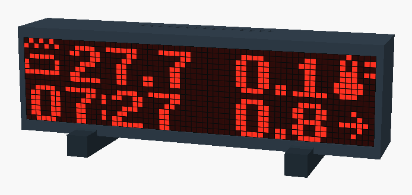
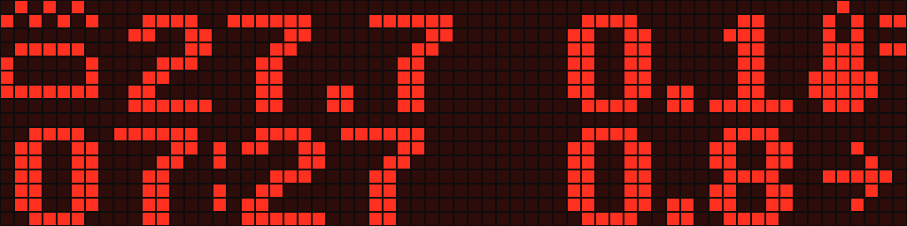
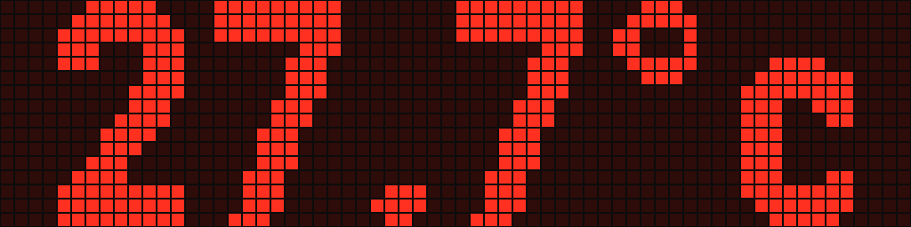
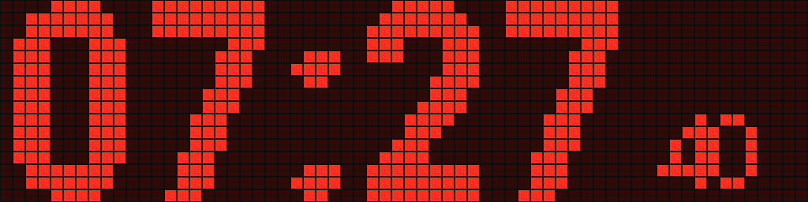
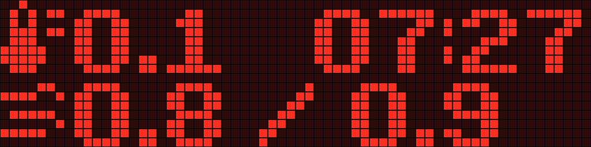
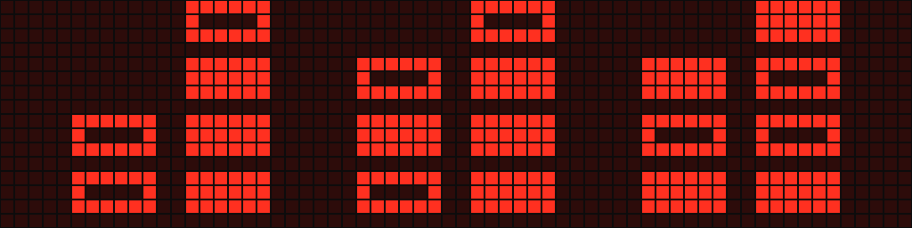
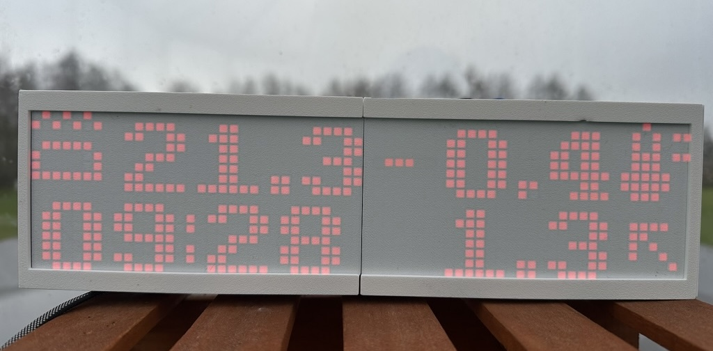

# MAX7219 hot tub display — ESPHome package

I built this 64 × 16 LED dot-matrix display for a wood-fired hot tub. It runs on
**ESPHome** and takes everything it shows from **Home Assistant**: the tub and outdoor
temperature, the wind with an arrow pointing where it blows as seen from the tub, the
time, and a countdown. It's 16 **MAX7219** 8 × 8 matrices driven by an ESP32 or ESP32-C3,
in a 3D-printed case.

<p align="center">
  <br>
  <sub>The 3D-printed case, rendered with a frame captured from a running display.</sub>
</p>

> **Not waterproof.** The case is vented, for a dry, sheltered spot near the tub, not the
> splash zone. Keep the USB power adapter away from the water; only 5 V goes to the
> display.

## Features

- **Seven presets**, switched from Home Assistant: Hot Tub, Hot Tub Big, Wall Clock,
  Night Clock, Weather, Countdown and Binary Clock.
- **Sensors picked in Home Assistant.** Type the entity IDs on the device page; no
  reflash, no YAML change.
- **Automatic brightness** from a light sensor, or manual 0–15. Night Clock always
  uses the lowest level.
- **°C or °F**, converted when the source sensor reports the other unit.
- **Wind arrow relative to you**: set once which way you face when you look at the
  display.
- **Countdown** with start and stop buttons; "DONE!" flashes over any preset at zero.
- **Fast MAX7219 driver**: a frame takes 8 SPI transfers instead of 4,096 (4 ms instead
  of about 100 ms), so the ESP stays free for WiFi and Bluetooth.
- **3D-printable case** with a pixel grid, as OpenSCAD source and STL files.

## Presets

| Preset | |
| --- | --- |
|  | **Hot Tub**: tub temperature, outdoor temperature and time. Bottom right alternates wind speed and gust every 3 s, next to the wind arrow. |
|  | **Hot Tub Big**: the tub temperature, large enough to read from the water. |
|  | **Wall Clock**: hours and minutes with a blinking colon, plus seconds. |
|  | **Night Clock**: hours and minutes at the lowest brightness. |
|  | **Weather**: outdoor temperature, time, wind speed and gust. |
|  | **Countdown**: minutes and seconds left. |
|  | **Binary Clock**: hours, minutes and seconds as binary-coded digits. |

The images are frames dumped from a running display, not mock-ups; see
[Screenshots](#screenshots).

## How it came about

I built it for a wood-fired hot tub: a Japanese-style bath heated by a stove, with no
thermostat. A stove and a tub full of water have a lot of inertia: the temperature keeps
climbing well after the fire is going, and drops slowly once it burns down. So the
temperature is kept right by hand, from the tub. When it climbs past the target, adjust
the flue; when it starts to drop, add more wood. To catch either in time the water
temperature has to be in sight from the tub, so it's always on the display (Hot Tub Big
shows it large enough to read from the water), next to the weather and the time.

<p align="center">
  <br>
  <sub>The display next to the tub.</sub>
</p>

A wind direction in degrees means little to someone sitting in the water, so the arrow
turns with the Viewer Facing setting and points where the wind blows as seen from the
seat. The white screen in front of the LEDs catches the light from the tub's
lighting, so the background of the display seems to change colour along with it.

ESPHome's own MAX7219 driver worked, but sending one frame took about 100 ms, half of one
core at five frames a second. When I added the Home Assistant sensors, the ESP started
losing WiFi. I changed the driver to send each frame in 8 SPI transfers instead of 4,096;
a frame now takes 4 ms and the WiFi trouble hasn't come back.

Every now and then a reboot left the whole matrix bright red and the ESP restarting in a
loop. For a while I unplugged the matrix, let the ESP boot and plugged it back in. The
cause turned out to be the data lines floating while the ESP boots, and three 10 kΩ
resistors fixed it. [hardware/README.md](hardware/README.md#the-pull-down-resistors) has
the details.

I didn't want to reflash every time the display should show another sensor, so the
entity IDs are set in Home Assistant.

## Requirements

- ESPHome 2026.10.2 or newer, with the ESP-IDF framework.
- Home Assistant with the ESPHome integration. The time and every value on the display
  come from Home Assistant.
- An ESP32 or ESP32-C3 board with USB-C, a USB-C power adapter, 16 MAX7219 8 × 8 matrices
  and three 10 kΩ resistors: see [hardware/README.md](hardware/README.md).

### Tested with

- An ESP32 dev board (`esp32dev`), ESPHome 2026.10.2, Home Assistant 2026.11.
- 16 MAX7219 on a 264 × 64 mm panel, powered through the ESP32 board's USB-C, 15–20 cm
  cable at 4 MHz, with the pull-downs.
- An Ecowitt weather station (outdoor temperature, wind speed, gust and direction, solar
  lux) and a hot tub temperature sensor.
- ESP32-C3: the case is built for one and the firmware compiles; not yet run on the
  display.

## Hardware

Wiring, power through the ESP32 board's USB-C, and the pull-down resistors that keep it
out of a red-screen brownout loop at power-up: [hardware/README.md](hardware/README.md).
The case, its print settings and assembly: [hardware/case](hardware/case/README.md).

## Installation

1. Wire the display as described in [hardware/README.md](hardware/README.md).
2. Copy [examples/esp32.yaml](examples/esp32.yaml) or
   [examples/esp32-c3.yaml](examples/esp32-c3.yaml) to your ESPHome config folder and set
   the pins.
3. Add `api_key`, `wifi_ssid` and `wifi_password` to your `secrets.yaml`.
4. Install it from the ESPHome dashboard, or with `esphome run your-file.yaml`.
5. Home Assistant finds the device: Settings → Devices & services → **ESPHome** →
   *Configure*.

The examples include this package, pinned to a release:

```yaml
packages:
  hottub: github://jut-a/esphome-max7219-hottub/max7219-hottub.yaml@0.1.0
```

## Configuration

On the device page (Settings → Devices & services → ESPHome → your display), under
**Configuration**:

| Setting | What to enter |
| --- | --- |
| Hot Tub Temp Entity | Entity ID of the tub temperature, e.g. `sensor.hot_tub_temperature` |
| Outdoor Temp Entity | Entity ID of the outdoor temperature |
| Wind Speed Entity, Wind Gust Entity | Entity IDs of the wind sensors, shown in their own unit (see [Units](#units)) |
| Wind Direction Entity | Entity ID of the direction the wind comes from, in degrees (0 = north) |
| Solar Lux Entity | Entity ID of a light sensor in lux, for automatic brightness |
| Temperature Unit | °C or °F |
| Viewer Facing | Compass bearing you face when you look at the display (0 = north, 90 = east) |

Leave an entity field empty if you don't have that sensor. The device restarts about 5
seconds after an entity ID changes, because Home Assistant only sends sensor values that
the device asks for when it connects.

## Entities

| Entity | Description |
| --- | --- |
| Display | Turns the matrix on and off |
| Display Preset | One of the [presets](#presets) |
| Brightness Mode | **Auto** follows the Solar Lux sensor; **Manual** uses Brightness |
| Brightness | 0–15, used in Manual mode, and in Auto when no Solar Lux Entity is set |
| Countdown Minutes | Length of the countdown, 1–120 minutes |
| Start Countdown, Stop Countdown | Start the countdown, or stop it and clear "DONE!" |
| Countdown | Time left, as text |
| Dump Frame | Diagnostic, disabled by default. Logs a frame of the current preset for [screenshots](#screenshots), also while the display is off |

Plus the settings under [Configuration](#configuration).

## How it works

- **Wind arrow.** The arrow shows where the wind blows *to*, seen from where you sit: up
  is away from you, down is into your face. With no direction, or when the wind speed is
  0, a plain wind icon is shown instead.
- **Automatic brightness.** Every 10 seconds the Solar Lux value sets the level: below
  10 lx 0, below 100 lx 2, below 1,000 lx 5, below 10,000 lx 9, below 50,000 lx 12,
  otherwise 15. With no Solar Lux Entity set, Auto uses the Brightness setting instead.
  While a set lux sensor has no value (right after a restart, or with the sensor or Home
  Assistant offline) the level stays where it is; the display starts at the lowest level.
- **Units.** Temperatures are converted to the Temperature Unit; wind is shown in the
  sensor's own unit. See [Units](#units).
- **Boot screen.** "Booting..." until WiFi connects, then the device's IP address for 5
  seconds, also after every reconnect.

## Units

The display shows numbers without units, so what matters is the unit each sensor reports
and whether the number fits.

| Value | Shown in | Converted on the device |
| --- | --- | --- |
| Temperatures | The **Temperature Unit** setting, °C or °F | Yes, between °C and °F, by the sensor's unit. Other units (K) are shown as they are |
| Wind speed and gust | The sensor's own unit | No: pick the unit in Home Assistant |
| Wind direction | Degrees the wind comes from, 0 = north | No. A text direction ("NW") counts as no direction, and the plain wind icon is shown |
| Solar Lux | Lux | No. The automatic brightness steps are in lux |

**Temperature.** Home Assistant sends temperatures in your unit system (°F on a US
install) or in the unit set on the entity (entity settings → *Unit of measurement*). The
device converts only when that differs from Temperature Unit, so nothing is converted
twice. Every preset fits in both units: from 100° (a hot tub in °F) the tub temperature
drops its decimal, and the outdoor temperature has a decimal only between −10° and 10°.

**Wind.** Nothing is converted on the device; the number is shown as Home Assistant
reports it. To change the unit, set it in Home Assistant on both the speed and the gust
entity (entity settings → *Unit of measurement*: m/s, km/h, mph, knots and more, for
entities with the wind speed device class). Use the same unit for both. The unit decides
how much fits:

| Speed / gust | Hot Tub (alternating) | Weather |
| --- | --- | --- |
| 3.4 / 5.1 m/s | 3.4, 5.1 | 3.4 / 5.1 |
| 7.6 / 11.4 mph | 7.6, 11.4 | 7.6 / 11.4 |
| 12.2 / 18.4 km/h | 12.2, 18.4 | 12 / 18 |
| 95.0 / 104.0 km/h | 95.0, 104 | 95 / 104 |

Weather shows speed and gust on one line, which has room for one decimal on at most one
two-digit value; otherwise both drop the decimal. Hot Tub drops it from 100. In m/s that
only happens in strong wind; in km/h, mph or knots two-digit values are everyday. Beaufort
is shown with a decimal too ("4.0").

**Brightness.** Some weather stations report sunlight as solar radiation in W/m² instead
of lux. Use the station's lux sensor if it has one; otherwise a template sensor in Home
Assistant that multiplies W/m² by roughly 120 gives a usable lux value.

## Options

Substitutions you can set in your device file:

| Substitution | Default | |
| --- | --- | --- |
| `pin_din`, `pin_cs`, `pin_clk` | `GPIO25`, `GPIO26`, `GPIO27` | Pins wired to the matrix |
| `matrix_rotate_chip` | `"0"` | Turns each 8 × 8 matrix: `"0"`, `"90"`, `"180"` or `"270"` |
| `matrix_lines_style` | `ZIGZAG` | `ZIGZAG` when both rows start at the same end, `SNAKE` when the second row runs back |
| `ha_hot_tub_temp`, `ha_outdoor_temp`, `ha_wind_speed`, `ha_wind_gust`, `ha_wind_dir`, `ha_solar_lux` | empty | Entity IDs for the first start |
| `viewer_facing_initial` | `"0"` | Viewer Facing for the first start |

The `ha_*` and `viewer_facing_initial` values are only used the first time the device
starts. After that the values stored on the device win, so change them in Home
Assistant.

Any other display setting can be changed with `!extend`, for example a slower SPI clock
for a long cable:

```yaml
display:
  - id: !extend led_matrix
    data_rate: 1MHz
```

The package brings its own SPI bus (`matrix_spi`) and Home Assistant clock
(`matrix_time`), so it doesn't clash with ones already in your config.

## Screenshots

```sh
python3 tools/capture_frames.py your-file.yaml docs/img/
```

Run it with the Python that has ESPHome installed, plus Pillow (`pip install pillow`). It
reads the device's address and API key from your config the way `esphome logs` does,
switches through the presets, dumps three frames of each and keeps the one with the most
lit LEDs (so blinking colons show), then puts your preset back. It writes one PNG per
preset, named after it, and works while the display is switched off. Pixels are drawn
square, the way the case's grid shows them; add `--style round` for bare LEDs.

By hand: enable the **Dump Frame** entity in Home Assistant, run
`esphome logs your-file.yaml | tee frames.log`, press **Dump Frame** on each preset, then
run `python3 tools/render_frames.py frames.log docs/img/`.

## FAQ

### Do I need a hot tub?

No. The clocks, Weather and Countdown work without one; leave Hot Tub Temp Entity empty.

### Which sensors can I use?

Any Home Assistant entity with a numeric state: a weather station, a weather service's
sensors, a pool or tub thermometer. [Units](#units) explains which units are converted.

### Does it work without Home Assistant?

No. The clock and every value on the display come from Home Assistant.

### Do I need the pull-down resistors?

With the matrix powered through the ESP32 board's USB-C, the way I build it: yes. Without
them, now and then a reboot latches the matrix into its test mode: every LED on at full
current, about 5 A. USB can't deliver that, so the ESP browns out and restarts over and
over, and the screen stays bright red. Three 10 kΩ resistors from DIN, CLK and CS to GND
make every boot clean. CLK and CS can go on any module, but the one on DIN has to be on
the first module.

The other ways are optional:

- **A separate 5 V supply of about 5 A for the matrix**: the ESP gets through test mode,
  with a red flash on some boots, so the resistors aren't needed.
- **USB-C without the resistors**: it works most of the time. When the red screen shows
  up, unplug the matrix's 5 V, let the ESP boot and plug it back in.

Details: [hardware/README.md](hardware/README.md#the-pull-down-resistors).

### Why does it replace ESPHome's own `max7219digit` driver?

ESPHome's driver sends every byte as its own SPI transaction: 4,096 per frame for 16
chips, about 100 ms. At 5 frames a second that took about half of one core on my ESP32,
which also lost WiFi; this driver sends a frame in 8 transfers (about 4 ms) and the
dropouts are gone. It also re-sends the chips' control registers
every 10 seconds, so a glitch can't leave the display stuck with every LED on. If ESPHome's
driver gets the same change, this copy will be dropped.

### Can I use a different size of matrix?

The layouts are drawn for 64 × 16 pixels. Other sizes need changes to the display lambda
in [max7219-hottub.yaml](max7219-hottub.yaml).

## Troubleshooting

| Symptom | What to check |
| --- | --- |
| **Every LED lights up at power-up and the ESP keeps restarting** | The chips latched into display-test mode while the ESP booted. Fit the [pull-down resistors](hardware/README.md#the-pull-down-resistors) or use a 5 V supply of about 5 A; until then, unplug the matrix's 5 V, let the ESP boot and plug it back in. |
| **8 × 8 blocks are rotated, mirrored or in the wrong order** | `matrix_rotate_chip` and `matrix_lines_style`; for mirrored text, `reverse_enable` or `flip_x` with `!extend`. |
| **A value shows `--` or nothing** | The entity ID under Configuration: exact ID, numeric state. After a change the device restarts within about 5 s; the log warns about an invalid ID. |
| **Clock presets are blank** | The time comes from Home Assistant: check the device is connected. |
| **Random pixels or flicker** | A long or noisy cable: lower `data_rate` with `!extend`, shorten the cable, or add a level shifter (see [hardware/README.md](hardware/README.md#wiring)). |
| **Build error: `max7219digit` or `ha_dynamic` not found** | Your config folder has its own `components/` folder, which ESPHome searches first. Rename it. |
| **Build fails after an ESPHome update** | ESPHome changed its own `max7219digit` driver. Check for a newer release here, or stay on the previous ESPHome version until then. |

### Reporting a problem

Open an [issue](https://github.com/jut-a/esphome-max7219-hottub/issues/new/choose) with
what the display shows, your ESPHome version and board, your device YAML without
secrets, and the log from boot (`esphome logs your-file.yaml`). A Dump Frame log shows
exactly what was drawn.

## License

- Code: [GPL-3.0](LICENSE). The `max7219digit` driver is derived from ESPHome's (its C++
  code is GPL-3.0), which was written by rspaargaren.
- Case: [CC0 1.0](https://creativecommons.org/publicdomain/zero/1.0/) (public domain),
  see [hardware/case](hardware/case/README.md).
- Fonts: Victoria Bold by devurandom, from
  [A package of 8-bit fonts for Grafx2 and Linux](https://opengameart.org/content/a-package-of-8-bit-fonts-for-grafx2-and-linux)
  (CC0), with tighter spacing in `fonts/VictoriaBold-8-tight.bdf`. Roboto Condensed and
  DotGothic16 are downloaded from Google Fonts when you compile.
