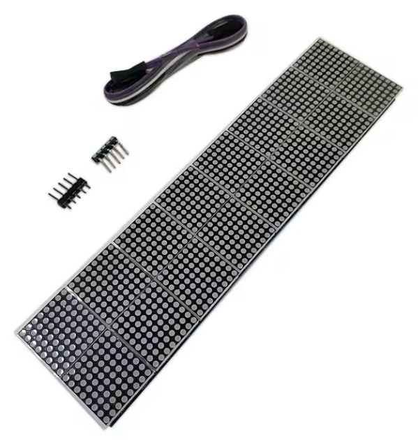

# Hardware

## Parts

| Part | Notes |
|---|---|
| ESP32 dev board, or an ESP32-C3 board, with USB-C | Also powers the matrix, see [Power](#power). The case has room for a C3. A dual-core ESP32 has more headroom if it also runs a Bluetooth proxy |
| 16 MAX7219 8×8 LED matrices | One board with 16 chips as 64 × 16 pixels, 264 × 64 mm, which is what the case fits. See [the board](#the-board) below |
| 3 × 10 kΩ resistor | Pull-downs on DIN, CLK and CS, see [below](#the-pull-down-resistors) |
| USB-C power adapter | For the ESP32 board, which passes 5 V on to the matrix |
| Case | 3D-printed, see [case/](case/README.md) |

### The board

   
  The board as sold, with its cable and pin headers. Product photo: AliExpress listing.

On AliExpress it's sold as "MAX7219 8\*8 8 16Dot Matrix LED Display Module Digital Tube
Microcontroller Control Drive Board 5V For Arduino Electronic DIY Kit", for example:

- [listing 1005004600176940](https://www.aliexpress.com/item/1005004600176940.html), option
  **16 bit**
- [listing 1005006222492232](https://www.aliexpress.com/item/1005006222492232.html), option
  **16 bits Red**

Pick the 16-chip option; the listings have other options too. Listings come and go, so if
these are gone, search for the title. Any 16 MAX7219 chips in two rows of eight
work with the firmware, but check the size against the case.

## Wiring

| Matrix input | ESP32 | ESP32-C3 |
|---|---|---|
| VCC | 5V pin of the board | 5V pin of the board |
| GND | GND | GND |
| DIN | GPIO25 | GPIO7 |
| CS | GPIO26 | GPIO10 |
| CLK | GPIO27 | GPIO6 |

Connect the ESP to the input pins of the first module. The pins are set with
the `pin_din`, `pin_cs` and `pin_clk` substitutions, so other free GPIOs work
too.

The 16 chips form one daisy chain across both rows. `matrix_lines_style` tells
the driver how the second row is laid out: `ZIGZAG` (the default) if it starts
at the same end as the first row, `SNAKE` if it runs back the other way. If
each 8×8 block shows up rotated, set `matrix_rotate_chip`.

The MAX7219 runs at 5 V and the ESP's signals are 3.3 V, slightly below the
3.5 V the chip asks for as a logic high. This works with most modules,
including mine. If you get random pixels that the pull-downs
don't fix, put a 74AHCT125 level shifter in the three signal lines.

## Power

I power the whole display through the ESP32 board's USB-C port: the matrix's VCC comes
from the board's 5V pin, so one USB-C power adapter runs everything. That is enough
because the presets light only a fraction of the LEDs. The worst case, every LED on, is
about 5 A, and that only happens in display-test mode, which the pull-down resistors
below prevent.

Optional: if the ESP restarts at high brightness, give the matrix its own 5 V supply and
connect the grounds.

## The pull-down resistors

With the matrix powered through the ESP32 board's USB-C, fit them: three resistors make
every boot clean. They only become optional with a separate, large supply for the matrix
(see [the table below](#three-ways-to-deal-with-it)).

### What goes wrong without them

While the ESP resets and runs its bootloader, nothing drives DIN, CLK and CS. On a
15–20 cm cable the floating lines pick up noise, and now and then the MAX7219s read it as
a frame that switches on display-test mode: every LED on at full current, whatever the
brightness setting. For 16 chips that is about 5 A. A USB supply can't deliver that, so
the 5 V rail collapses, the ESP browns out and restarts, the lines float again, and the
matrix can latch the same way again. You see a bright red screen and a device that never
finishes booting.

It's random. Whether the noise forms a frame, what that frame writes, and whether the
supply holds out until the firmware starts (the first thing it does is switch display
test off) changes from boot to boot. Mine came up fine on most reboots and stuck in the
red screen on some.

Once the firmware runs, the ESP drives the lines and the risk is gone. The driver also
re-sends the MAX7219 control registers every 10 seconds, so a register corrupted later
heals itself.

### Three ways to deal with it

| | What happens |
| --- | --- |
| **USB-C power and 10 kΩ pull-downs** (how I build it) | The lines stay low while the ESP boots, nothing latches, every boot is clean. |
| Optional: **a separate supply for the matrix that covers all LEDs on**: 5 V, about 5 A or more, with wiring that carries it | The ESP rides through display-test mode until the firmware switches it off. Some boots flash the whole screen bright red for a moment. No resistors needed. |
| Optional: **USB-C power without the resistors** | It works most of the time. Now and then a boot ends in the red screen and restart loop: unplug the matrix's 5 V, let the ESP boot, plug it back in. That was my workaround until I fitted the resistors. |

### Fitting them

A 10 kΩ resistor from each of DIN, CLK and CS to GND. I put them at the matrix end, so
they stay put when the ESP is swapped. The three don't have to sit on the same module,
except for DIN:

- **CLK → GND and CS → GND can go on any module.** CLK and CS run through every module,
  so any CLK or CS pad is the same line. Pick whichever pads are easiest to solder.
- **DIN → GND has to go on the first module**, on the input pads where the cable from the
  ESP arrives. Each module's DIN is the previous module's output, so a resistor anywhere
  else holds the wrong line. Check with a continuity tester against the ESP-side wire.

CS is pulled down rather than up because the matrix board only has 5 V. When the firmware
starts it raises CS once, which at most re-latches what the chips already hold.

## ESP32-C3

- Keep the matrix off GPIO2, GPIO8 and GPIO9. They are boot strapping pins,
  and the pull-downs would start the C3 in the wrong mode. Also avoid GPIO18
  and GPIO19 (USB) and GPIO20 and GPIO21 (serial). GPIO4–7 and GPIO10 are safe.
- The C3 has a single core and less RAM. The display alone is fine; adding a
  Bluetooth proxy on top makes RAM tight.

## Case

The OpenSCAD source, STL files, print settings and assembly steps are in
[case/](case/README.md).
