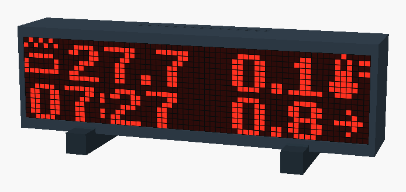

# Case

A desk-style enclosure for a 264 × 64 mm MAX7219 panel: a pixel grid in front of
the LEDs, room for an ESP32-C3 on the back cover, and two feet. Outer size
271.2 × 78.8 × 49.25 mm. Every part fits a small print bed; one-piece versions are
included for large beds.

   
  Rendered from matrix_case.scad, with a frame captured from a running display. GitHub shows
  each .stl file below in a 3D viewer.

> **Not waterproof.** The case is vented. Put it somewhere dry and sheltered, out of
> the splash zone.

## Parts

| File | Print | What it is |
| --- | --- | --- |
| [body_left.stl](body_left.stl), [body_right.stl](body_right.stl) | 1 each | The case, in two halves joined with keys |
| [lid_left.stl](lid_left.stl), [lid_right.stl](lid_right.stl) | 1 each | The back cover. Its stepped joint bridges the body seam |
| [keys.stl](keys.stl) | 1 | Four alignment keys for the body seam |
| [foot.stl](foot.stl) | 2 | Feet |
| [grid_left.stl](grid_left.stl), [grid_right.stl](grid_right.stl) | 1 each | **Option A:** open pixel grid |
| [skin_grid_left.stl](skin_grid_left.stl), [skin_grid_right.stl](skin_grid_right.stl) | 1 each | **Option B:** pixel grid with a closed 0.4 mm front, see [the front](#the-front-grid-and-diffuser) |

On a bed that takes 271 mm plus a brim, [body.stl](body.stl), [lid.stl](lid.stl) and
[pixel_grid.stl](pixel_grid.stl) or [skin_grid.stl](skin_grid.stl) replace the halves.

Print these two test pieces first:

- [fit_test.stl](fit_test.stl): a corner of the body, to check the front lip against your
  panel.
- [grid_test.stl](grid_test.stl): a 16 × 16 section of the grid. Hold it over the lit
  display to check that the cells line up with the LEDs.

You also need 8 M3 × 10 screws, soft insulating foam, insulating foam tape and glue.

## Print settings

PLA, 0.4 mm nozzle, 0.2 mm layers, no supports.

| Part | Orientation | Settings |
| --- | --- | --- |
| Body | Front bezel down, cavity up | 4 walls, 20 % gyroid infill, 5 top and bottom layers, 5 mm brim if needed |
| Lid | Flat outside face down, posts up | 4 walls, 6 top and bottom layers |
| Grid | Flat face down, as supplied | Black filament for the walls (skin grid: the first two layers white or clear, see below). Check in the slicer preview that all the 0.5 mm walls are there |
| Feet, keys | As supplied | Your usual settings |

## The front: grid and diffuser

The grid turns each LED into a square pixel: its black walls keep the light of one LED out
of the cells next to it. In front of the grid something has to spread the light over the
cell. There are three ways to do it:

| Front | Looks |
| --- | --- |
| **Skin grid** (option B): the front is printed with the grid | Square pixels, even light. What I use |
| **Open grid** (option A) with a diffuser in front: 2 mm plexiglass (opal or frosted), paper, or matte film, cut to 264 × 64 mm | Square pixels; how even depends on the material. The case leaves room for 2 mm |
| **Open grid, nothing in front** | Round pixels, because you see the LEDs themselves, and very bright, even at the lowest brightness setting |

I like the white screen of the skin grid over the LEDs: it catches the light from the hot
tub's lighting, so the background of the display seems to change colour along with it.

### Printing the skin grid

The skin grid is 4 mm deep: a solid 0.4 mm front with 3.6 mm of open cells behind it.
Print it face down with fixed 0.2 mm layers (no adaptive layers):

1. Print the first two layers (Z = 0.2 and 0.4 mm) in white or clear (transparent)
   filament. They are the diffuser.
2. Change to **black** before the third layer, the one ending at Z = 0.6 mm, with your
   printer's colour change or pause. These layers are the walls between the pixels. In
   white filament the walls carry light into the neighbouring cells, and the pixels bleed
   into each other.

STL files carry no colours, so set the change in the slicer and check it in the slicer's
colour preview. Make sure the two front layers have no gaps. Filament translucency
varies: print a section first, for example `grid_test`, before both full halves.

## Assembly

1. Glue the four keys into the sockets at the seam and glue the two body halves together.
2. Glue the two grid halves edge to edge. The centre join stays visible; avoid
   overlapping strips and keep glue off the lit face.
3. Through the open back, put in the grid against the front bezel (option B: white face
   forward), then the LED panel. The grid should touch the panel's plastic, not raised
   LED lenses; add edge spacers if needed.
4. Put soft insulating foam behind the panel. With the skin grid, the gap from the back of
   the panel to the tips of the lid's retaining posts is about 4.35 mm: start with about
   4.5 mm of foam and adjust for very light compression. Never tighten the lid so it bends
   the panel or presses on the LEDs. A diffuser or a different grid changes the gap.
   On mine the posts were a bit short, so I stuck a couple of thick adhesive rubber pads
   on them. To print longer posts instead, lower `pad_rigid_gap` in the .scad; it only
   changes the lid.
5. Stick the ESP32-C3 to the platform on the inside of the lid with insulating foam tape,
   or strap it through the slots next to it. The USB cable leaves through the opening in
   the lid. Check that no wire or component is pinched.
6. Fit the two lid halves with the 8 M3 × 10 screws. Each lid half screws into both body
   halves, which braces the seam.
7. Stand the case in the two feet.

The grid is a regular 64 × 16 array: 4.125 × 4 mm pitch with 0.5 mm walls. If your panel
has wider gaps between its modules, cells near those joins can shade the LEDs; check with
`grid_test` on the lit display.

## Changing the design

Open [matrix_case.scad](matrix_case.scad) in OpenSCAD. Pick a part in the Customizer
(`part`), render it (F6) and export it as STL; `assembly` is for viewing only. The
settings at the top cover the panel size (`matrix_width`, `matrix_height`,
`matrix_depth`), fit (`side_clearance`, `front_lip`), the grid (`grid_depth`,
`grid_wall`), the lid joint, the ESP platform position (`esp_x`) and the tilt in the feet
(`desk_tilt`). Assertions in the file stop values that don't fit.

## License

[CC0 1.0](https://creativecommons.org/publicdomain/zero/1.0/) (public domain).
